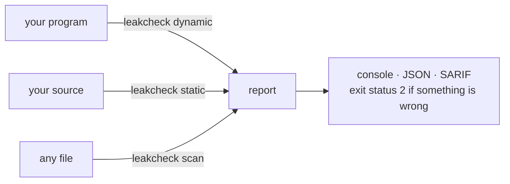

# leakcheck

Finds memory leaks, leaked handles, deadlocks and trojan behaviour in C and C++ programs,
on Linux and Windows. No learned guesses: every finding comes from watching the program run,
or from following pointers through its source. The exception is opt-in and says so —
`scan --ai`, a classifier you train yourself, whose measured accuracy travels with it.



| Mode | What it does | Needs | Runs on |
|---|---|---|---|
| `dynamic <program>` | Runs the program with a tracker inside it and reports what really happened | a built program, no recompiling | Linux, macOS, Windows (64-bit) |
| `static <source>` | Reads the source and follows pointers and handles through each function | files, a folder or `compile_commands.json` | Linux, Windows |
| `scan <file or folder>` | Looks at files for malware without running anything | any file | Linux, Windows |

## Try it

**Linux** (CMake 3.28+, a C++20 compiler, Python 3 for the tests):

```sh
cmake -S . -B build -G Ninja && cmake --build build
build/leakcheck dynamic ./my_program arg1
```

**Windows** (MinGW-w64 `g++` and Python 3; no CMake needed):

```powershell
.\build-windows.ps1 -Test
build\leakcheck.exe dynamic .\my_program.exe arg1
```

On macOS, `leakcheck dynamic` inserts `libleakcheck_preload.dylib` with `DYLD_INSERT_LIBRARIES` and a `__DATA,__interpose` table, so the same checks run: the heap, descriptors, streams, directories, sockets, `execve`/`posix_spawn`, `fork`/`wait`, and the behaviour rules on `open`/`exec`/`connect` (including `/etc/passwd` and `~/.ssh`). Still Linux-only: ptrace injection, `/proc`, memfd, and the glibc mutex owner fields. A binary signed with the hardened runtime ignores `DYLD_INSERT_LIBRARIES`. `--malware` has its own
macOS tables (launch agents, the keychain, Gatekeeper and SIP bypass, ...): see
[docs/REFERENCE.md](docs/REFERENCE.md#macos).

Build your program with `-g` and the reports name functions and lines:

```
[1] ERROR double-free: free() on a 16-byte block that was already freed
    second release here:
      #0 double_free at heap_errors.c:11
      #1 main at heap_errors.c:83
    first released here:
      #0 double_free at heap_errors.c:10
    allocated here:
      #0 double_free at heap_errors.c:9
```

```sh
leakcheck static src/                          # or: static build/compile_commands.json -f sarif -o out.sarif
leakcheck scan ./downloads/                    # nothing in it is executed
leakcheck dynamic -f json -o report.json ./my_program
```

Options go before the program; everything after the program is its own. Exit status:
`2` when anything is found (`--error-exitcode n` changes it), `1` for a usage error or when nothing
could be analysed, otherwise the program's own status.

## What it finds

* **Memory**: leaks (definitely, indirectly, possibly lost), double free, use after free, buffer
  overflow and underflow, `malloc`/`new`/`delete` mismatches.
* **Handles and descriptors**: files, sockets, streams, directories, threads and processes that are
  never closed, closed twice, or used after closing; handles a child program inherits.
* **Locks**: two locks taken in opposite orders (a deadlock waiting for bad timing), a lock taken
  twice, a thread that ends holding one, a wait without the lock, a lock used after it was destroyed.
* **Trojan behaviour** (`dynamic`): reverse shells, droppers, persistence, credential theft, process
  injection, ransomware renames, network scans, programs and host names that pass for the system's.
* **Weak source** (`static`): format strings, command injection, unbounded copies, hard-coded secrets,
  check-then-use races, weak crypto — and, for the findings about outside text, the route it took to
  get there: `argv` in `main.c`, onto a variable, through two functions in other files, into `system()`.
  A parameter is followed across files, so the call that hands an attacker's text to a sink elsewhere is
  reported at the point it is passed, with the whole path (`flow` in JSON, `codeFlows` in SARIF).
* **Suspicious files** (`scan`): the EICAR test file, web shells, miners, executables dressed as
  documents, packed binaries, scripts that decode and run themselves.
* **A trained verdict on Windows programs** (`scan --ai`, opt-in): every `.exe` and `.dll` read is
  also shown to a small classifier over its headers, sections, imports and strings, trained on real
  malware and normal programs. It is a guess from the shape of the file and is reported as a warning
  with its score — see [A trained classifier](#a-trained-classifier---ai) below.
* **Named malware families** (`--malware`, any mode, slower): virus, worm, trojan horse, ransomware,
  spyware, rootkit, keylogger, RAT, botnet, and on — see [docs/REFERENCE.md](docs/REFERENCE.md#malware-families---malware).

A finding is a warning when the program may have done it on purpose (an installer writes `~/.bashrc`);
the report says what happened and where, and you know whether it was meant to. `dynamic` runs the
program: run one you do not trust in a virtual machine.

## A trained classifier (`--ai`)

`scan --ai` gives every Windows program a second opinion from a model trained on known
malware: a forest of 400 small decision trees (LightGBM) over 49 numbers read out of the PE
headers — section layout, entry point, imports, exports, data directories, overlay, entropy,
the strings inside. It is the one thing here that is learned rather than observed, so it is
opt-in, and its verdict is a warning that carries its own score.

```sh
build/leakcheck scan --ai ./downloads/
# [1] WARNING ai-classifier: its Windows headers, sections and strings look like malware's,
#     not a normal program's: a classifier trained on 9898 Windows programs (3284 malicious,
#     6614 normal) from crovax/CNN_Project (an old Windows system), a Windows 11 installation
#     scores it 0.997 of 1 (99% malicious, threshold 52%)
#     ... This is a guess from the shape of the file, not a matched rule
```

The model lives in `model/pe-malware.ai` — plain text, one line per tree node, so a change to
it can be read in a diff. `--ai-model <file>` uses another one, `--ai-threshold <0..1>` moves
the bar. It reads the file, never runs it.

Judge it on files of your own, and see what a stricter bar would do:

```sh
python3 tools/evaluate.py --sweep ./samples/clean ./samples/bad:malware
```

That is the number to trust for your own programs. The one below is for the collection it was
trained on: 1,623 files the model never saw, with the split made by sample family (files that
share an import table stay on one side, so no copy of a training file lands in the test set):

| | |
|---|---|
| accuracy | **99.7%** (1,618/1,623), balanced 99.6% |
| false alarms | 1 of 1,080 normal programs |
| missed | 4 of 543 malicious programs |
| ROC AUC | 1.000 |
| size | 231 trees, 285 KB of text, 42 of 49 features used |

The normal side is two Windows generations — an old system's DLLs and 4,001 programs,
assemblies, drivers and vendor runtime DLLs from a current Windows 11 install, the latter
added because the first model flagged 610 of them on a real machine. The model also leaves out seven numbers that say
how a file was built rather than what it contains (debug directory, PDB path, Rich header,
checksum, bitness): on the old corpus 100% of the normal programs have a debug directory and
8% of the malware do, which would teach "stripped means malicious" — false of a legitimate
release. Dropping them costs nothing measurable and removes the shortcut. Details:
[docs/MODEL.md](docs/MODEL.md).

On that same Windows 11 machine (System32 and SysWOW64; 8,819 of its 30,898 files hold code
and are judged) the shipped model flags **2 files, 0.02%** — `powershell_ise.exe` and
`msiexec.exe`, both the 32-bit copies. Before the modern normal programs were in the training
set it flagged 610: `.mui` resource files, kernel drivers, installers, .NET hosts.
Resource-only files are not judged at all now — by the scanner or by the trainer — and drivers
are; the before-and-after numbers are in
[docs/MODEL.md](docs/MODEL.md#a-real-windows-installation-as-a-false-alarm-test).

Retraining it, if you want to:

```sh
python3 -m venv .venv-train && .venv-train/bin/pip install numpy lightgbm
python3 tools/fetch_dataset.py --per-class 3000   # 3.6 GB of real malware and normal programs
python3 tools/fetch_benign.py --windows /mnt/c/Windows   # normal programs from a real install
.venv-train/bin/python tools/train_ai.py           # writes model/pe-malware.ai + its metrics
```

A model like this is what fails on the next packer, which is why the finding is a warning: it
says what it saw, with a number, and leaves the decision. `--ai` roughly doubles the time of a
scan over a folder of Windows programs and costs nothing on other files.

## On Windows

The same checks work on 64-bit Windows programs, using the Windows calls: heap, `CloseHandle`,
critical sections and SRW locks, the registry, `CreateProcess`. Not offered there: signals, `fork`,
SIGPIPE. Only 64-bit programs; Windows 10 (1903) or later for folders with non-ASCII names.
Details and limits: [docs/REFERENCE.md](docs/REFERENCE.md#windows).

## Taking part

leakcheck is [MIT licensed](LICENSE). A false alarm or a missed detection is worth reporting
even without the file: the SHA-256, the score and what the program is, enough for the next
model to be measured against it. [CONTRIBUTING.md](CONTRIBUTING.md) has the build, test and
retraining rules; [SECURITY.md](SECURITY.md) says how to report something that should not be
public, and why no sample has to be attached to an issue.

## More

* [docs/MODEL.md](docs/MODEL.md): the `--ai` model — its data, features, evaluation, results
  and what they do not say.
* [docs/REFERENCE.md](docs/REFERENCE.md): every finding, option, suppression rule and limit.
* [docs/DESIGN.md](docs/DESIGN.md): how each engine works, with diagrams.
