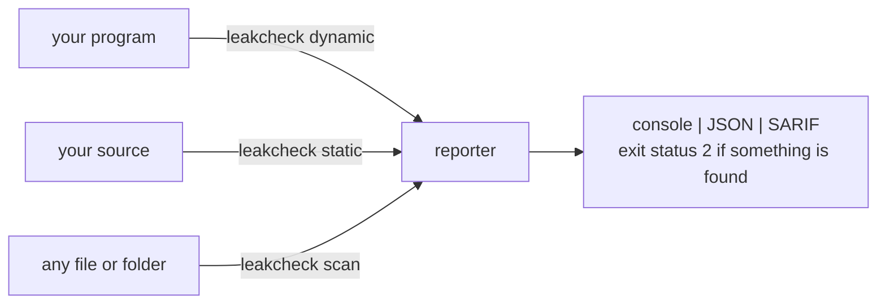

# leakcheck

> This repository is named `drydock`; the tool it contains is **leakcheck**, and that is the name of the binary, the CMake project and every doc.

leakcheck is a command-line bug and malware checker for C and C++ programs, written in C++20. It has three independent modes. They share one reporter, so you get the same console, JSON and SARIF output and the same exit status from each.



| Mode | What it does | Needs | Platforms |
|---|---|---|---|
| `dynamic <program>` | Runs the program with a tracking library loaded into it and reports what actually happened. | A built program. No recompiling. | Linux, macOS, Windows (64-bit) |
| `static <source>` | Parses the source and follows pointers, handles and locks through each function. | Files, a folder or `compile_commands.json`. | Linux, Windows; also builds and is tested on macOS |
| `scan <file or folder>` | Reads files and looks for signs of malware. Nothing is executed. | Any file. | Linux, Windows; also builds and is tested on macOS |

A fourth command, `ai-features`, prints the numbers that `scan --ai` reads from each Windows program. It exists for training the classifier and is not needed for normal use.

## Quick start

**Linux or macOS** (CMake 3.28+, a C++20 compiler, Python 3 for the tests macOS is not tested on real hardware!):

```sh
cmake -S . -B build -G Ninja && cmake --build build
build/leakcheck dynamic ./my_program arg1
```

**Windows** (MinGW-w64 `g++` and Python 3; CMake is not needed):

```powershell
.\build-windows.ps1 -Test
build\leakcheck.exe dynamic .\my_program.exe arg1
```

Build your program with `-g` and the report names functions and lines:

```
[1] ERROR double-free: free() on a 16-byte block that was already freed
    second release here:
      #0 double_free at heap_errors.c:11
      #1 main at heap_errors.c:83
    first released here:
      #0 double_free at heap_errors.c:10
    allocated here:
      #0 double_free at heap_errors.c:9
```

```sh
leakcheck static src/                                   # or: static build/compile_commands.json -f sarif -o out.sarif
leakcheck static --diff-base main -f markdown src/      # PR-only scan with GitHub Markdown output
leakcheck static --metrics src/                         # security metrics, issue density, debt score
leakcheck static --disable-rule persistence src/        # roll out or silence rules by ID
leakcheck triage report.json                            # interactive terminal triage & baseline management
leakcheck scan ./downloads/                             # nothing in it is executed
leakcheck dynamic -f json -o report.json ./my_program   # JSON and SARIF in dynamic mode need -o
```

Options go before the program. Everything after the program name is passed to the program unchanged.

**Exit status:** `2` when anything is found (`--error-exitcode n` changes this). `1` for a usage error or when nothing could be analysed. Otherwise, in `dynamic` mode, the program's own status.

**Run untrusted programs in a virtual machine.** `dynamic` executes the program.

## What it finds

**Memory** (`dynamic` and `static`)
- Leaks (definitely, indirectly and possibly lost), double free, invalid free, use after free, buffer overflow and underflow, and `malloc`/`new`/`delete` mismatches.
- `dynamic` catches reads of freed memory and overflows immediately when you use `--guard-every n`.

**Handles and processes** (`dynamic` and `static`)
- Files, sockets, streams, directories, threads and child processes that are never closed, closed twice, or used after closing.
- Descriptors that leak into child programs.
- Zombie processes and threads that are never joined.

**Locks and timing** (`dynamic` and `static`)
- Two locks taken in opposite orders (a deadlock that needs unlucky timing). Across files, `static` follows this too.
- A lock taken twice, a thread that ends holding a lock, a condition wait without the lock, and a lock used after it was destroyed.
- Unsafe calls inside signal handlers, and a `send()` that can raise SIGPIPE.

**Malicious behaviour at run time** (`dynamic`)
- Reverse shells, droppers, persistence, credential theft, process injection, ransomware-style renames, network scans, and programs or host names that imitate the system's.

**Weak source code** (`static`)
- Format strings, command injection, unbounded copies, hard-coded secrets, check-then-use races and weak crypto.
- For findings caused by outside text, the report shows the route it took, for example from `argv` in `main.c`, through two functions in other files, into `system()`. This is `flow` in JSON and `codeFlows` in SARIF.

**Suspicious files** (`scan`)
- The EICAR test file, web shells, miners, executables with a document's extension, packed binaries, and scripts that decode and run themselves.

**Named malware families** (`--malware`, any mode, slower)
- 100 families, from virus, worm and ransomware to rootkit, botnet and firmware malware. Each has its own finding type, so a suppression can target one family. The catalogue is [`shared/include/malware.h`](shared/include/malware.h).

A finding is a *warning* when the program may have done it on purpose (an installer that writes `~/.bashrc`). It is an *error* when it is a definite bug. `static` results are always warnings, because it works without a compiler front end and cannot see types or macros. Full detail is in [docs/REFERENCE.md](docs/REFERENCE.md).

## How it works

- **Dynamic.** `leakcheck` forks, sets `LD_PRELOAD` (`DYLD_INSERT_LIBRARIES` on macOS) to its runtime library, `libleakcheck_preload`, and `exec`s your program. The library replaces `malloc`, `free`, `operator new`, `open`, `pthread_*` and similar calls, records every call, and writes findings to a report file. The CLI then resolves stacks with `addr2line`, applies suppressions and renders the report. On Windows the runtime is `leakcheck_preload.dll`. It is injected into the process and hooks the heap through import tables ([ADR-0001](docs/adr/0001-windows-dynamic-engine.md)).
- **Static.** A lexer, then a parser that produces functions and statement trees, then a dataflow analysis for each function. A separate pass over tokens (`security.cpp`) handles source weaknesses. There is no compiler front end, so it runs anywhere in milliseconds, and it is tuned for few false alarms rather than completeness.
- **Scan.** Detects the file type (ELF, PE, Mach-O, script or text), then applies name checks, signatures and command-line rules. `shared/include/rules.h` holds the lists of names, paths, hosts and command lines. `dynamic` and `scan` both use it, so a script on disk and the same command at run time are judged alike.

The design document ([docs/DESIGN.md](docs/DESIGN.md)) explains each engine with diagrams.

## Repository layout

| Path | Contents |
|---|---|
| `src/` | The CLI entry point (`main.cpp`) and the Windows manifest and resource file. |
| `dynamic-engine/` | `include/` has the dynamic mode driver. `src/preload/` is the injected runtime for Linux and macOS: heap, guard pages, leak scan, locks, signals, sockets, resources and behaviour rules. `src/win/` is the Windows runtime. |
| `static-engine/` | The lexer, parser, analyzer, source-weakness checks (`security.cpp`), file scanner (`scan.cpp`, `scan_engine.cpp`), malware tables, and the PE feature extractor and model loader for `--ai`. |
| `reporter/` | Stack symbolization, suppressions, and the console, JSON and SARIF renderers. |
| `shared/include/` | Headers used by both the CLI and the injected runtime: the report-stream protocol, the rule lists and the malware catalogue. |
| `model/` | `pe-malware.ai`, the shipped classifier (a text file), and its metrics. |
| `tools/` | Python scripts to fetch datasets, train the classifier and evaluate it. |
| `suppressions/` | Ready-made suppression rules (`python.supp`). |
| `tests/` | `unit/` has C++ white-box tests. `dynamic/programs/` has deliberately buggy programs. `static/cases/` has sample sources. `run_tests.py` drives the CLI suites. |
| `eval/` | About 245 small cases (bugs plus correct "trap" programs that must stay silent) and `RESULTS.md`, produced by `run_eval.py`. |
| `docs/` | Reference, design, model description and the ADR. |
| `build-windows.ps1`, `CMakeLists.txt` | The Windows (no CMake) and CMake builds. |

## The optional classifier (`scan --ai`)

Everything above reports what was observed or traced in the code. `--ai` is the exception: a LightGBM model (231 trees over 49 numbers from PE headers, sections, imports and strings, of which 42 are used) gives each Windows `.exe` and `.dll` a score. The model is opt-in, and it is reported as a warning that carries the score, because it is a guess from the shape of the file.

```sh
build/leakcheck scan --ai ./downloads/
python3 tools/evaluate.py --sweep ./samples/clean ./samples/bad:malware   # judge it on your own files
```

On its held-out test set (1,623 files, split by sample family) it reached 99.7% accuracy: 1 false alarm among 1,080 normal programs and 4 misses among 543 malicious ones. On a clean Windows 11 `System32`/`SysWOW64` it flags 2 of 8,819 programs that contain code. These numbers describe the collection it was trained on. For your own software, measure it with `tools/evaluate.py`. The data, features, limits and retraining steps are in [docs/MODEL.md](docs/MODEL.md).

## Documentation

| Document | Read it for |
|---|---|
| [docs/REFERENCE.md](docs/REFERENCE.md) | Every finding, option, suppression rule, platform difference and limit. |
| [docs/DESIGN.md](docs/DESIGN.md) | How each engine works, with diagrams and trade-offs. |
| [docs/MODEL.md](docs/MODEL.md) | The `--ai` classifier: data, features, evaluation and what the numbers do not say. |
| [docs/adr/0001-windows-dynamic-engine.md](docs/adr/0001-windows-dynamic-engine.md) | Why the Windows runtime hooks the heap through import tables. |
| [eval/RESULTS.md](eval/RESULTS.md) | Per-case results of the evaluation suite. |
| [CONTRIBUTING.md](CONTRIBUTING.md), [SECURITY.md](SECURITY.md) | Build, test and retraining rules, and how to report a security issue. |

## License

[MIT](LICENSE). A false alarm or a missed detection is worth reporting even without the file. The SHA-256, the score and what the program is are enough.
