# Design

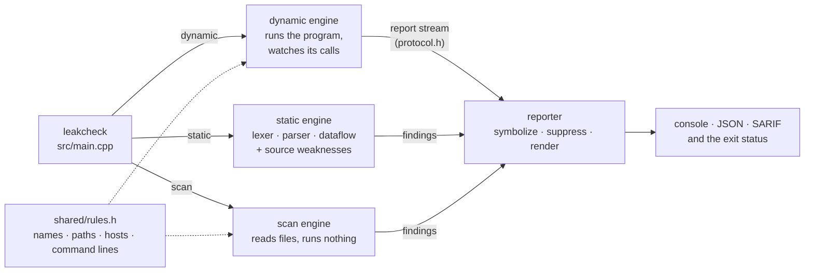

*Three modes feed one reporter. The dynamic engine and the scanner judge names, paths and command lines with one list, so a script on disk and the same command at run time are treated alike.*

## Dynamic engine

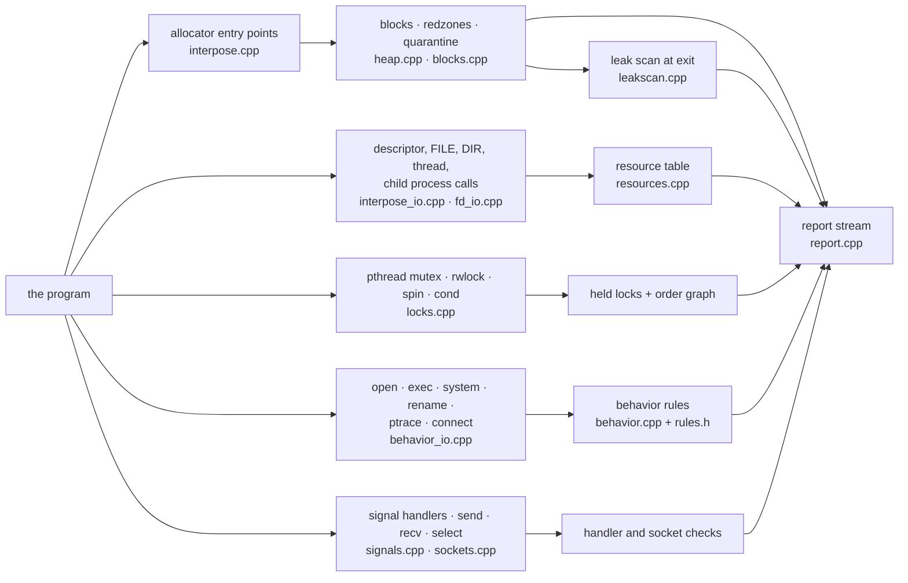

*Every wrapper in the injected runtime feeds one table, and every table reports through one stream. On Windows the same tables and rules are fed by hooks instead of wrappers (see "The Windows runtime").*

### Injection

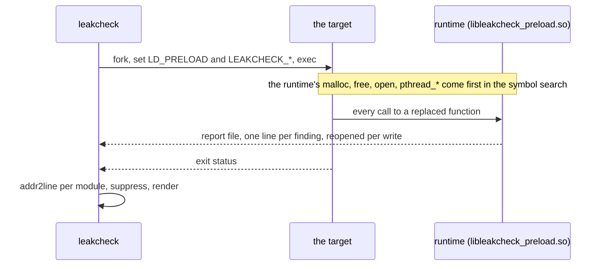

*The runtime lives inside the target, so it sees every call; the only thing between them is a file that is reopened for each write, which a program closing its descriptors cannot silence.*

`leakcheck dynamic` forks; the child sets `LD_PRELOAD` to
`libleakcheck_preload.so` (next to the `leakcheck` binary), a temporary report
path and its own pid as the "root" process, then `execvp`s the target. A
close-on-exec pipe tells the parent whether `exec` failed. The parent ignores
Ctrl-C while waiting, like a shell, so it can still report on an interrupted
run.

The library defines `malloc`, `free`, `calloc`, `realloc`, `reallocarray`,
`memalign`, `aligned_alloc`, `posix_memalign`, `valloc`, `pvalloc`,
`malloc_usable_size` and all 20 replaceable `operator new`/`delete` forms.
Being first in the symbol search order, these replace libc's for the program
and for libc's internal callers (`strdup`, `fopen`, ...). The real allocator is
reached through glibc's exported `__libc_malloc` family, so no `dlsym`
bootstrapping is needed. The library links only against libc and is built
without exceptions or RTTI: it can be injected into C programs.

Two invariants keep it safe inside every allocation:

* It never calls `malloc` itself. All metadata lives in `mmap`ed memory.
* Some libc functions it calls do allocate (`backtrace` loads the unwinder,
  `pthread_getattr_np` reads `/proc`). A thread-local "in hook" flag routes
  those nested calls to a small internal heap that is never tracked.

### Per-block records

Each allocation gets a 64-byte record (user pointer, underlying pointer,
size, kind: `malloc`/aligned/`new`/`new[]`, live or freed, allocation and free
stacks, thread ids, sequence number) in a sharded open-addressing hash table:
64 shards, each with its own spin lock, linear probing with backward-shift
deletion. Call stacks are interned (identical stacks share one id) in a
second sharded table, so a record only stores two 32-bit ids.

### Layout and checks

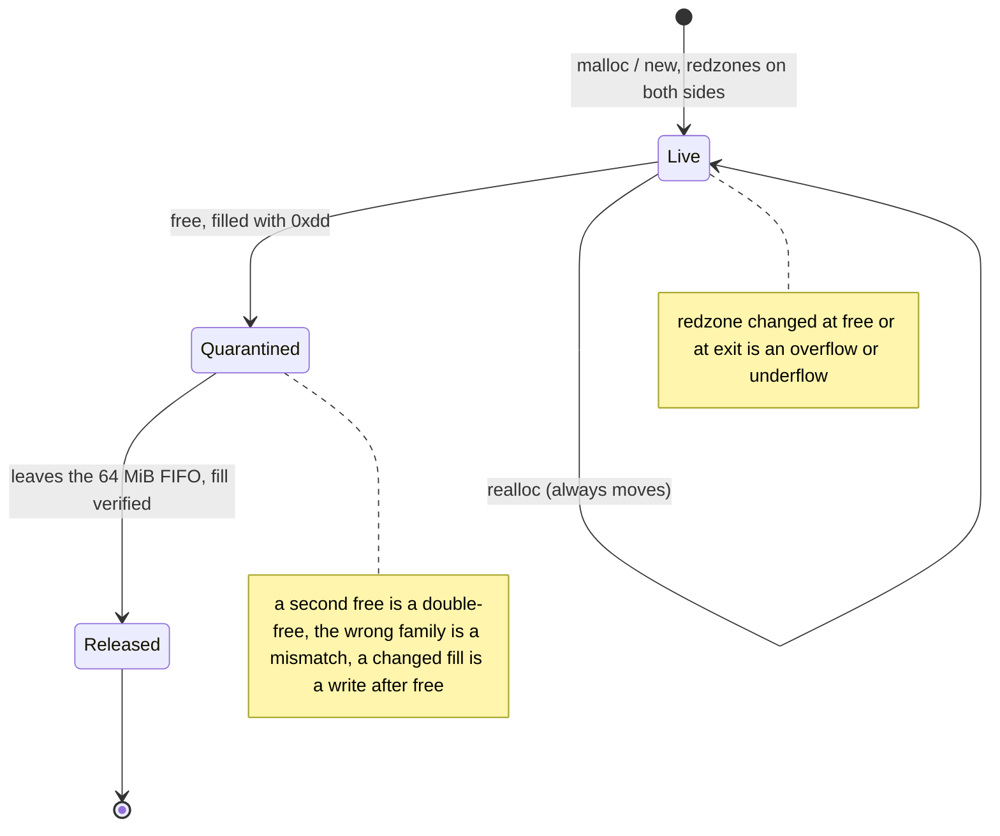

*A block never goes back to the allocator at once, so a pointer kept after free still names the dead block and every misuse of it can be told from a new allocation.*

```
| left redzone 32B | user block (size) | right redzone 32B |
```

Redzones hold a position-dependent byte pattern. On `free` (and for live
blocks at exit) a changed pattern is a heap buffer overflow/underflow,
reported with how many bytes were overwritten.

On `free` the record is looked up:

* not found: invalid free. The address is classified as a thread's stack,
  static memory of a module, a pointer into a block, or leakcheck's freed-memory
  fill pattern (a pointer read out of a freed block);
* already freed: double free, with the allocation, first-free and second-free
  stacks;
* allocated by a different family: `alloc-dealloc-mismatch`;
* sized `delete` with the wrong size: `free-size-mismatch`.

Freed memory is filled with `0xdd` and parked in a FIFO quarantine (64 MiB by
default) instead of being returned to libc. While it is parked, the address
cannot be reused, so a later free of the same pointer is always recognised
as a double free. When a block leaves the quarantine its fill is verified:
any changed byte is a write after free. `realloc` always moves the block, so
stale pointers into the old block are caught the same way.

### Guard pages (`--guard-every n`)

Sampled blocks are allocated with `mmap` as
`[inaccessible page][data pages][inaccessible page]`, right-aligned so the
block ends at the trailing guard page. On free the data pages are made
inaccessible too. A SIGSEGV handler maps the faulting address to the block:
inside a freed block is use after free (read or write, from the page-fault
error code), in a guard page is an overflow or underflow. The access stack
starts at the faulting instruction. After reporting, the page is made
accessible again and the program continues (unless `--abort-on-error`).
Faults that are not ours are passed to the previous handler.

### Leak scan

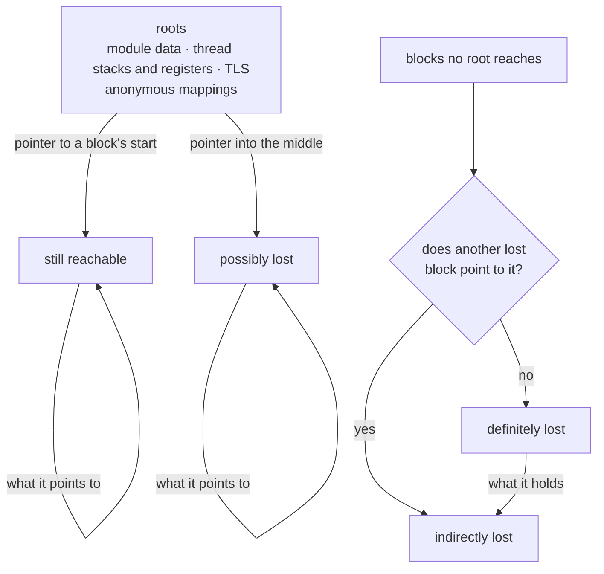

*The classification is valgrind's: a block is judged by how it is reached, and the contents of a lost block are lost with it, but only its head is reported as definite.*

The scan runs when `main` returns (`__libc_start_main` is wrapped) or when
`exit`/`_exit` is called, before atexit handlers, like LeakSanitizer.
Starting at the hook's own frame matters. Everything below it on the stack
is either dead (frames of functions that returned, full of stale pointers)
or the scanner's own frames (full of block addresses). Callee-saved
registers are spilled into the hook frame first.

Roots: writable segments of every loaded module (to the end of their last
page), the stacks of all threads (registered through a `pthread_create`
wrapper) plus their TLS, the internal heap, and anonymous private mappings.
Excluded from the anonymous mappings are those that contain heap blocks, the
runtime's own mappings, and thread stacks. A region that disappears while
being scanned is skipped (SIGSEGV/SIGBUS during the scan jump to the next
page). The internal heap holds libc and ld.so state allocated inside the
runtime's own calls (a `FILE` from a wrapped `fopen`), so it is a root; its
blocks are zeroed when freed, since stale pointers there made a leaked
block's child "possible" instead of "indirect" in about one run in 200 (a
freed record's numbers happened to fall inside the child).

Classification, matching valgrind:

1. From the roots, follow pointers to block starts transitively: *still
   reachable*. Pointers into a block's middle are remembered.
2. Blocks reached through such interior pointers, and everything reachable
   from them: *possibly lost*.
3. The remaining blocks are lost. Lost blocks that no other lost block points
   to are *definitely lost*. Everything reachable from them is *indirectly
   lost*; each cycle without a head yields one definite block.

Groups with the same category and allocation stack are reported once, with
block and byte counts. On the test programs, git and perl, the definitely and
indirectly lost totals match valgrind's byte for byte.

With `LEAKCHECK_DANGLING=1`, the scan then looks for dangling pointers: the
freed blocks still in quarantine (not yet released, so their address is not
reused) are sorted, and every word of each *reachable* block and of the
writable segments of the program's own modules (not system libraries, not
stacks) is looked up there; a word equal to a freed block's start is
reported with the holder's and the freed block's stacks. It is opt-in
because quarantine holds the most recent frees, which at exit are mostly
teardown: node reports 51, python, find and tar one or two stale globals
each, all harmless.

### Report stream and symbolization

The runtime writes one line per record (`shared/include/protocol.h`) by
reopening the report file for each write, so programs that close their file
descriptors cannot silence it. Frames are `module-id:offset` pairs relative
to the module's load bias, so PIE, non-PIE and shared objects resolve the
same way. The CLI groups frames by module, runs `addr2line -a -f -C -i` once
per module (inlined frames included), and trims frames below `main` or the
thread entry. Repeated identical findings are counted, not repeated. A suppression `top:` matches only the innermost frame of each stack.

### Processes and threads

`fork` handlers take every runtime lock before the fork and release them in
both processes. Children that are not traced keep a consistent allocator
but do not report. Programs started with `exec` inherit `LD_PRELOAD` but
stay passive unless `--trace-children` is given.

### Resources (`resources.cpp`, `interpose_io.cpp`)

The runtime also exports the libc calls that create and release
descriptors, `FILE` and `DIR` streams, and child processes
(`interpose_io.cpp`). That file
includes none of the headers that declare them; streams are passed as
`void *`, which C linkage does not mind. Each wrapper calls libc first, then
updates one table keyed by handle type and value (descriptor number or
stream address) with the creating call, its stack, thread and process.
Calls made while the runtime itself is working (`tl_in_hook`, such as
reopening the report file) are not tracked, and a signal handler that closes
a descriptor while its thread holds the table lock skips the update rather
than deadlocking.

* A stream or directory takes over its descriptor: `fopen`, `fdopen` and
  `opendir` drop any record for `fileno`/`dirfd`, and closing the stream
  marks that descriptor closed, so a later `close(fd)` is a double close.
* `close` updates the table after libc answers. `EBADF` on a descriptor the
  table saw closed is a double close; `EBADF` on any other number is ignored
  (programs close numbers blindly). A second `fclose`/`pclose`/`closedir` is
  reported and refused, since glibc would release the stream's memory twice.
  `fread`, `fwrite`, `fgets` and `fprintf` (and the `v` / `_chk` forms of
  `fprintf`) on a stream the table holds as closed are a `use-after-close`
  and are not passed on either: the `FILE` has been freed. A stream opened
  again at the same address is an Open record and is not the closed one.
  A stream the table never saw, or whose closed record was purged, is left
  alone.
* Released handles stay as "closed" records so a double close can name the
  first close. Above 65,536 records the closed ones are dropped.
* Threads: the `pthread_create` wrapper passes its stack to the new thread.
  When a thread started that way exits (a thread-specific-data destructor)
  and `pthread_getattr_np` says it is still joinable, it is recorded;
  `pthread_join`, `pthread_tryjoin_np`, `pthread_timedjoin_np`,
  `pthread_clockjoin_np` and `pthread_detach` remove the record. A thread
  detached at any time is never reported, and running threads are not judged.
* A successful join or detach also goes into a ring of the last 256, with
  its stack and the handle's generation; a join or detach of the same
  thread again is a `double-join`, reported before the call goes on (glibc
  answers `EINVAL` while the descriptor sits in its cache). glibc gives a
  finished thread's `pthread_t` to the next thread, so each thread started
  through the wrapper gets a generation, kept in a table by handle: set by
  the creator after `pthread_create` returns (the thread may not have run
  yet) and by the thread before its function runs (it may detach itself
  first). A join or detach reads the generation before the call, while the
  handle still names its thread, and a record matches only the generation
  the handle has now: no timing between threads can make an earlier
  thread's record count. Generation 0 (a thread started elsewhere, or a
  handle lost to a table collision) never matches.
* Child processes: `fork`, `posix_spawn` and `posix_spawnp` record the
  child's pid; `wait`, `waitpid`, `wait3`, `wait4` and `waitid` (without
  `WNOWAIT`) remove it. At the end a recorded child is reported only if
  `waitid(WEXITED | WNOHANG | WNOWAIT)` finds it exited and uncollected: a
  zombie. A child still running is not judged, and one reaped where the
  wrappers could not see it (or with `SIGCHLD` ignored) is no longer ours.
  `system()` and `popen()` start and wait for their children inside libc,
  so those never reach the wrappers.
* Descriptors inherited by children: `system`, `popen` and `posix_spawn`
  (without file actions, which may close them) first look through the
  table for open descriptors this process created whose `F_GETFD` lacks
  `FD_CLOEXEC`, and report each with the stack that starts the child.
  The `exec` family (`execve`, `execv`, `execvp`, `execvpe`, `fexecve`, `execveat`, and
  `execl`/`execlp`/`execle`, rebuilt as argument arrays on the stack) does
  the same for every descriptor still open, whoever opened it: a fork
  child's table is its parent's. An untraced child writes no stream of its
  own, so this one finding is written into the shared report file as a
  lone record (no header, no totals); its key hashes return addresses, not
  stack ids, which are numbered per process, and the CLI merges equal keys
  from such headerless pids into one finding with an occurrence count. A
  `vfork` child is recognised by `getpid()` differing from the pid recorded
  at start and in each `fork` child (it shares that memory) and is skipped.

Open handles are judged in `finish_report`, after `main`'s static
destructors and `atexit` handlers ran (the runtime's own destructor runs
last), not at the memory leak scan, which happens when `main` returns. A
descriptor is reported only if the kernel still has it open (`fcntl
F_GETFD`), so one closed somewhere the wrappers cannot see (inside libc) is
not. A forked child inherits the table but reports only what it opened
itself.

The CLI folds a memory leak into a resource leak when the block's
allocation stack is the handle's open stack with only system-library frames
on top: a leaked `DIR` would otherwise also be a 32 KB "definitely lost"
block from glibc's `__alloc_dir`. (A leaked `FILE` is not lost memory: glibc
keeps every stream on a list.) `fcloseall` marks every tracked `FILE*` and pipe stream closed, so a later `fread` is a `use-after-close`.

### Locks (`locks.cpp`)

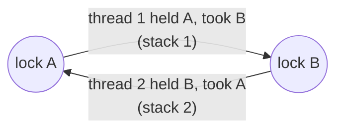

*Each lock taken while another is held adds an edge. A new edge that closes a path back to its start (up to four edges) is a deadlock that needs only unlucky timing, reported with both stacks. No thread has to be waiting for it to be found.*

The runtime exports the lock, try, timed, clock, unlock, init and destroy
calls of `pthread_mutex_*`, `pthread_rwlock_*` (read and write) and
`pthread_spin_*`, forwarding to glibc through `dlsym(RTLD_NEXT)` (the lock
and unlock ones resolved at load: the unwinder takes locks while the
runtime captures stacks, and calls made inside the runtime pass straight
through). Two helpers carry all of them: one for calls that may wait, one
for try and timed calls.

* Each thread keeps the locks it holds (up to 16) with the return address
  of the call that took each one, and whether it holds a read lock: a full
  stack would cost an unwind per lock.
* Only an exclusive acquisition (mutex, spin lock, write lock) records
  edges, from every lock the thread holds, read locks included. An
  exclusive request waits for any holder while a read request waits only
  for writers (glibc's readers-first default), so in a cycle of such edges
  every lock is wanted exclusively while someone holds it: a real
  deadlock. Read-read orders are never edges.
* Locking B while holding A records the edge A -> B in one global table,
  with the stack of this lock and the one-frame stack of A's. Only a new
  edge takes the table's lock for long: it captures the stack and searches
  for a path B -> ... -> A of up to four edges. A path is a cycle of
  orders, a potential deadlock, reported once with both orders' stacks.
  This is the lock-order graph of Helgrind and ThreadSanitizer, without the
  data race detection.
* A try-lock creates no edge into the mutex it takes (it cannot wait), but
  later locks while holding it do.
* Waiting for itself is a certain deadlock: a normal or adaptive mutex
  (glibc's `__kind & 3`) or a spin lock the thread already holds, or a
  write lock on a read-write lock it holds for reading. It is reported,
  then `stop_program` closes the report and aborts rather than letting the
  run hang. (A recursive mutex may be relocked, an error-checking one and a
  write-held rwlock answer `EDEADLK`, and readers may read-lock again.)
  A mutex still listed as held, whose glibc `__owner` is neither this
  thread nor the forking thread in a child, was released by a foreign
  unlock: that record is dropped (`drop_stolen`) and the lock is not a
  double-lock. The real owner's list cannot be edited from the unlocking
  thread, so the drop happens on its next lock of that mutex.
* The thread-exit hook (the TSD destructor threads already use) reports
  mutexes still held. Main is checked when the report is finished: its key
  destructor runs after that, or not at all.
* `pthread_cond_wait`, `_timedwait` and `_clockwait` check that the mutex
  is in the thread's held list (`unlocked-wait`); a thread holding more
  than 16 locks skips the check, as its list is incomplete.
* `pthread_mutex_unlock` of a normal or adaptive mutex compares glibc's
  `__data.__owner` (the owner's tid) with the caller's tid
  (`foreign-unlock`). Error-checking and recursive mutexes answer `EPERM`
  themselves. Both misuse reports let the call go through: glibc's own
  behavior there is what the program would have seen. In a `fork` child
  glibc still names the parent's forking thread as the owner of what it
  held (a `pthread_atfork` prepare handler's locks), so that tid
  (`g_fork_tid`, set in the runtime's own prepare handler) counts as the
  child's main thread.
* `pthread_mutex_lock` of a mutex that is locked (`__lock` != 0) by an
  owner (`__owner`) that is not the caller (or the forking thread in a
  child) asks `tgkill(pid, owner, 0)`: ESRCH, with the lock still showing
  that owner afterwards, means no such thread, which is an `orphaned-lock`: the owner ended holding it, or it
  was another thread of the parent when the process forked, and the call
  would block forever. The program is stopped like for a double lock. The
  check costs a few loads for an unlocked mutex and one syscall for a
  contended one. It is emitted with `untraced_too`, since the usual place
  is a `fork` child, which is not traced by default. Robust (0x10) and
  process-shared (0x80) mutexes are skipped: they answer EOWNERDEAD, or the
  owner may be in another process.
* `unsafe_libc.cpp` wraps the libc functions that keep static state
  (`strtok`, `localtime`, `getpwnam`, ...; no libc headers, results are
  `void *`). Each has a `Watch`: the first calling thread, where it called,
  and up to four mutexes it held. A call from another thread is a
  `thread-unsafe-call` unless the two share a held mutex (then the function is
  marked serialized for good) or the first thread no longer exists
  (`tgkill`; the new thread becomes the first). The same thread calling
  again costs one compare (`tl_tid == first_tid`); reported once per function.
* `sockets.cpp` wraps `send`, `sendto` and `sendmsg`. A call without
  `MSG_NOSIGNAL` costs one compare of a thread-local epoch with `g_epoch`.
  When they differ (the thread's first such send, or the program changed
  SIGPIPE's action since: `signals.cpp` calls `sigpipe_action_changed` from
  its `sigaction` wrapper, which `signal()` goes through) the slow path asks
  `getsockopt(SO_TYPE)` (datagrams never raise SIGPIPE: the descriptor is
  marked `kDatagram` in `g_is_socket` so it is asked once), reads the action with `sigaction(SIGPIPE, NULL, ..)` and the
  thread's mask with `pthread_sigmask`, and remembers the epoch. A default
  action and an unblocked signal is a `sigpipe-exposure`, once per run
  (`g_reported`). The mask is per thread on purpose: SIGPIPE from a failed
  send goes to the sending thread, so main blocking it protects nothing for a
  worker started earlier. `sigprocmask` and `pthread_sigmask` bump the epoch,
  so a thread that then blocks SIGPIPE is checked again and stays silent.
  `write()` and `writev()` cannot take
  `MSG_NOSIGNAL`, so they get the same look when `g_is_socket[fd] == kSocket`.
  `res::opened` passes the creating call to `fd_opened`, which marks
  descriptors made by `socket()`, `socketpair()`, `accept()` and
  `accept4()` (a `dup` is not marked; a pipe must stay silent, since its
  writer is meant to die with the reader).
  The array is a gate that saves a `getsockopt` per write on files and
  pipes; `check_slow` asks the kernel again, so the gate never changes a
  result and has no mutation.
  The same file holds the work behind three more rules, each reached from
  `fd_io.cpp`'s wrappers or from `sockets.cpp`'s own `send` family:
  - `failed(fd, how)`: a call returned -1. Only `errno == EBADF` goes on, to
    `res::used_closed`, which reports a `use-after-close` if the resource
    table holds a *Closed* record for that number (opened and closed stacks
    come from the record). Open record (closed behind our back) or no record:
    silent. A number closed and opened again is Open and fails with another
    errno or works: silent.
  - `read_zero(fd, how)`: a read of nonzero length returned 0. `g_zero[fd]`
    counts them (`fd_changed`, called by `res::opened`/`closed`, resets it
    when a number changes hands); at 1000 it asks `getsockopt(SO_TYPE)`: a
    stream socket is a `socket-eof-spin`, anything else (file, datagram) is
    not. No read that returns data needs to reset the count: no data follows
    end of file on a stream socket.
  - `read_again(fd, how)`: `EAGAIN` a thousand times in a row on a stream socket is a `socket-eagain-spin` (a pipe, a file or a shorter run is not).
  - `before_bind(fd, addr, len)`: for AF_INET/AF_INET6 with a nonzero port
    on a SOCK_STREAM socket it asks the kernel for SO_REUSEADDR and
    SO_REUSEPORT (so a setsockopt *after* the bind does not count) and
    reports `bind-without-reuseaddr`, a warning, with the bind's stack. The
    reporter merges equal stacks, so one report per call site.
  - `select` and `pselect`: one compare of `nfds` with `FD_SETSIZE`. Greater
    is a `select-overflow` (the kernel copies `nfds` bits of an `fd_set`
    that holds `FD_SETSIZE`). In range, including exactly `FD_SETSIZE`,
    the wrappers only forward the call. Nothing runs until the call is made.
* `descriptor-limit`: `track_fd`, `track_pair` and `track_handle` in
  `interpose_io.cpp` call `note_failed(how)` when a creating call fails;
  with `errno` EMFILE or ENFILE it goes to `res::exhausted`, once per run.
  That scans the resource table (this process's open descriptors, streams and
  directories count too: they hold one), finds the open stack shared by most
  of them (quadratic over at most 2048 records, once), and reports with that
  record's opened stack as "opened here" and the failing call as "failed
  here". Reporting needs descriptors itself (`append_report` opens the report
  file for every write, the heap scan reads `/proc/self/maps`), so `rt.cpp`
  keeps a spare: at start-up `fd_reserve_make` duplicates `/dev/null` to the
  highest number the limit allows (at most 1023; with raw system calls, so
  the resource table never sees it, and CLOEXEC). `open_for_runtime` gives it
  up when its own `open` fails with EMFILE and `close_for_runtime` takes it
  again, so a program that grabs the freed slot right after the report does
  not starve the exit-time reports. The spare is verified by `fstat` before
  it is closed (the program may have closed it and reused the number). A
  limit lowered by the program after start-up leaves the spare above it:
  then the report can be lost; documented, not worked around.
* `recvmsg` that returns descriptors (`SCM_RIGHTS`) records each as opened by that call.
* `fd_io.cpp` wraps `read`, `write`, `recv`, `recvfrom`, `recvmsg`,
  `connect`, `bind`, `listen` and `shutdown`. Like `interpose_io.cpp` it
  includes no libc header (`ssize_t` is `long`), because a fortified `recv`
  or `read` declared in a header would clash with the definition. On the
  way it adds one compare of the result: data came back, or the call worked,
  and nothing else happens. Inside a hook, before the real function was ever
  looked up, `read` and `write` use the raw system call, so the runtime's
  own report output cannot recurse into `dlsym`.
* glibc's `pthread_mutex_destroy` stores -1 in `__kind`, which
  `pthread_mutex_init` or an initializer overwrites. A lock, try, timed
  lock, unlock or condition wait on a mutex with kind -1 is a
  `use-after-destroy` (and skips the unlock and wait checks, which would
  misread kind -1). No table: a mutex made again in place is never mistaken
  for the destroyed one. glibc's read-write and spin lock destroy leave no
  mark, so those are not checked.
* `pthread_*_destroy` of a lock in the thread's held list, or held by
  another thread, is a `destroy-locked`: for a mutex glibc's `__owner`
  tells; for a read-write or spin lock a probe through the real
  `trywrlock`/`trylock` (released at once if it succeeds), which needs no
  knowledge of their layout. Destroy, `init` and `free` of a block also
  drop the locks they cover from the held list, silently for the last
  two: a stale entry would make a later lock at that address a false
  self-deadlock, and a thread that frees an object under its own lock (the
  last reference) a false `lock-leak` at its exit.
* Addresses are reused: `init`, `destroy` and the heap's `free` (for the
  freed block's range, found by binary search in a sorted array of the
  mutexes that appear in edges) remove a mutex's edges, so a new mutex at
  the same address starts clean.

### Signal handlers (`signals.cpp`)

`sigaction` and `signal` (glibc's `signal` uses its internal sigaction, so
it is wrapped too) install a trampoline in place of the program's handler
and remember the handler with the stack that installed it. The trampoline
sets a thread-local "handling signal N" for the handler's duration. The
allocator entry points, `exit`, the `fopen`/`opendir` family and wrapped
stdio calls (`printf`, `fprintf`, their `_chk` and `v` forms, `puts`,
`fputs`, `fwrite`, `fflush`) report a `signal-unsafe-call` when it is set:
once per run of the handler, so the `malloc` inside `printf` does not
repeat it. `longjmp`/`siglongjmp` clear the mark, since they leave the
handler. Asking `sigaction` for the old action returns the program's own
handler, not the trampoline.

### Malware behaviour (`behavior.cpp`, `behavior_io.cpp`)

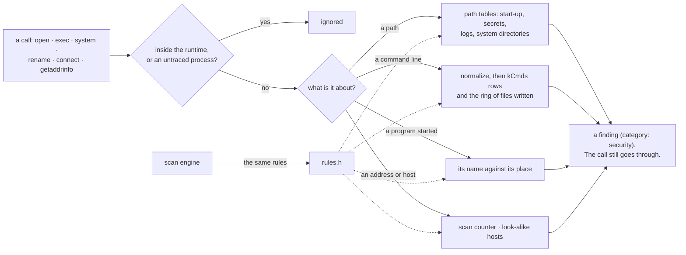

*The runtime reports what the program does and never stops it; the attempt is the behaviour, so a refused write to /etc/shadow is reported too.*

A trojan, backdoor or dropper is known by what it does to the machine, not by
how it is written, and every one of those things is a call into libc. The
module watches them and reports; it never stops the program. Findings have
category `security`; `persistence`, `credential-access`, `dropper` and
`anti-analysis` are warnings (installers, ssh and debuggers also do them), the
rest errors (`severity_of`). Nothing allocates: fixed buffers, `strstr`.

* **Hooks.** `interpose_io.cpp` calls `behavior::opening`/`opening_stream`
  before `open`, `open64`, `openat`, `openat64`, the four `__open*_2`
  fortify entries, `creat`, `creat64`, `fopen`, `fopen64`;
  `behavior::command` before `system` and `popen`; `behavior::exec`/`exec_fd`
  before `execve`, `execv`, `execvp`, `execvpe`, `fexecve`, `execveat`, `execl*`,
  `posix_spawn` and `posix_spawnp`. `behavior_io.cpp` (header-less like the
  other wrapper files) wraps `unlink`, `unlinkat`, `rename`, `renameat`, `renameat2`,
  `link`, `linkat`, `symlink`, `symlinkat`, `truncate`, `truncate64`, `chmod`, `fchmod`, `fchmodat`, `ptrace`,
  `process_vm_writev` and `setuid`/`seteuid`/`setreuid`/`setresuid`/`setfsuid`. The
  check runs before the real call, so a refused attempt (`EACCES` on
  `/etc/shadow`) is reported too: the attempt is the behaviour. `on()` is
  false inside the runtime and in untraced processes; `exec` and `command`
  also skip a `vfork` child (`getpid() != g_self_pid`), which runs on its
  parent's memory.
* **Findings are written with `untraced_too`.** A shell is started by a forked
  child about to `exec`; as for `inherited-descriptor`, the child's finding is
  written as a lone record in the parent's stream, or it would be lost.
* **Paths** are matched by four tables (`kStartup` for writes, `kNameResolution`
  for the name-resolution files, `kSecrets` for
  any access, `kLogs` for deletion or truncation). A rule is a needle starting
  with `/` found anywhere in the path (so `$TMP/etc/cron.d/x` matches, which
  the tests use), or, for file names (`at_end`), the end of the path
  (`/.bashrc` but not `/.bashrc.txt`). A relative path counts as if it began
  with `/`. Write intent is `O_WRONLY|O_RDWR|O_CREAT|O_TRUNC` or an `fopen`
  mode starting `w`/`a` or holding `+`. Appending to a log is silent
  (a logger does it); `O_TRUNC`, `truncate` and `unlink` of one are not. A
  rename away of a log is silent (rotation); a rename *onto* a start-up file
  is `persistence`. `/proc/<pid>/mem` and `environ` of another process are
  `process-injection` (written) or `credential-access`. A read of `/proc/<pid>/maps` is
  `anti-analysis`: injection helpers and anti-debugging code walk the memory map to see what is loaded where, and reading `/proc/self/status` is not the same tell.
* **Commands** (`system`, `popen`, and the argument of `sh -c` at an exec) are
  first made regular by `normalize`: quotes, parentheses and braces become
  spaces, spaces collapse, and `|` and `;` get a space on each side. A row of
  `kCmds` matches when every needle is present and the `none` needle is not
  (` crontab ` unless ` -l `); the needles carry their own spaces, which is
  what makes ` nc ` not match `func `. `downloads_into_interpreter` finds
  ` | sh` (also `/bin/bash`, `sudo bash`, `python`, ...) after a fetch or a
  decode. `starts_written_file` looks at the word that begins each command
  (and the script after an interpreter) against the written-name ring.
* **The written ring** holds 512 hashes of the file *names* (not directories)
  that were opened for writing, or renamed, linked or symlinked to. A program
  that starts a file it wrote is a `dropper`: at an exec, and in a command
  line. Names, because a relative path written and an absolute one run do not
  compare equal.
* **Exec.** `/proc/self/fd/N` and `/dev/fd/N` (what `fexecve` becomes) are
  resolved with `readlink`: a target `/memfd:...` or `... (deleted)` is
  `fileless-exec`; otherwise the target stands for the path in the checks that
  follow. A shell (by file name) with any of descriptors 0-2 a socket
  (`fstat`) is a `reverse-shell`; a `posix_spawn` file action that dup2s a socket onto 0, 1 or 2 counts the same.
* **ptrace.** `PTRACE_TRACEME` is `anti-analysis` only in the first process
  of the run (`g_self_pid == root_pid`): a debugger's forked child does it
  too. `PTRACE_ATTACH`/`SEIZE` of the parent is `anti-analysis` (it keeps
  debuggers out); of another process, and the `POKE*`/`SETREGS` requests, is
  `process-injection`. `unlink` of the program's own file (same name as
  `/proc/self/exe`, then `st_dev`/`st_ino`) is `anti-analysis`.
* `setuid(0)` and the others with an id 0 are reported when neither the real
  nor the effective user is root. `chmod`, `fchmod`, `fchmodat` with
  `S_ISUID|S_ISGID` in the mode are `privilege-escalation`.
* **Masquerade** (`kMasquerade`, an error). A name is not evidence; the
  directory is. `rules.h` holds the trusted names (`kTrusted`: `sshd`,
  `kworker`, `systemd`, ...), `kernel_thread_name` (`[kworker/0:1]`, or a
  name that begins `kworker/`, `ksoftirqd/`, ...), `system_dir` (`/bin`,
  `/usr`, `/lib`, `/boot`, ...) and `hiding_place` (`/tmp`, `/dev/shm`,
  `/run/user`, or any path component that starts with `.` and is not `..`).
  Reported when: the program's own path is a trusted name in a hiding place
  and not a system directory (`started`, at startup); `argv[0]` differs from
  the file's name and is a kernel-thread name, or a trusted name of a file
  that is not in a system directory (`starting`); `prctl(PR_SET_NAME)` sets
  a trusted name and the program itself is not in a system directory
  (`process_named`) — so `python3` in `/usr/bin` may call itself `kworker`;
  a create, rename, link or symlink puts a trusted name in a hiding place.
  Hosts: `imitates` (`rules.h`) folds look-alike letters (`0`→`o`, `1`→`l`,
  `3`→`e`, `rn`→`m`, `vv`→`w`) and accepts one insert, delete or change of
  the registrable label, and a trusted name embedded in a longer one
  (`github.com.evil.example`). The real host, and a name that ends in it
  (`api.github.com`), is not. Checked on the text of a command
  (`imitated_hosts`) and on `getaddrinfo` (`behavior::host`).
* **System tampering** (`kSystemTamper`, a warning). `system_file` is a path
  in a system directory that is not `/usr/share`, `/usr/include`,
  `/usr/src`, `/usr/local`, `/opt`, `/snap`, `/nix`, `/app` or a Python
  byte-code cache. Opening one for writing, removing it, renaming or linking
  onto it, or `chmod` of it, is the finding. Reading one is not.
* Not covered: `fchmod` has no path, so only the mode is said; a shell started
  by a program that was not traced (`--trace-children` makes children report
  their own); direct system calls.


### The Windows runtime (`dynamic-engine/src/win/`)

Windows has no `LD_PRELOAD`, and a program's calls to the heap are not symbols that loading a
library first can replace. So the runtime is a DLL, `leakcheck_preload.dll`, that the program
loads before its first instruction and that then redirects the program's calls by patching its
**import tables**. The decision, and what was rejected, is in
[adr/0001-windows-dynamic-engine.md](adr/0001-windows-dynamic-engine.md).

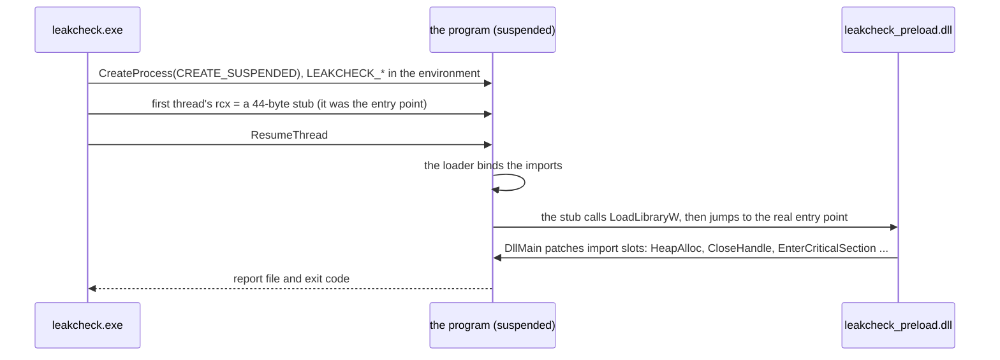

*A new process's first thread calls its entry point through rcx once the loader is done. Pointing rcx at a stub runs our code when kernel32 is ready and no program code has run, without changing a byte of the program (`shared/include/win_inject.h`; `--trace-children` uses the same code from inside the runtime).*

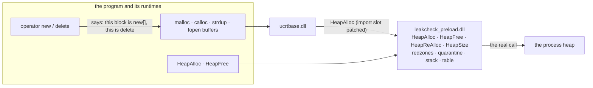

*Every allocation of a Windows process ends in the process heap, so the heap calls are the one place to watch. `free` and `operator new/delete` are hooked too, but only to say which family the block belongs to (that is how `new` released by `free` is found).*


What is shared with Linux, and what is not:

| | Linux | Windows |
|---|---|---|
| block table, redzones, quarantine, leak classification, report stream, resource table, lock order graph, behaviour and path rules, reporter | `blocks.cpp`, `heap.cpp`, `leakscan.cpp`, `report.cpp`, `resources.cpp`, `behavior.cpp`, `rules.h` | the same files, with `#ifdef _WIN32` only where the system shows through |
| getting the runtime in | `LD_PRELOAD` | the stub above, `win_inject.h` |
| seeing the calls | symbols that come first in the search order | patched import slots (`win_hooks.cpp`) |
| memory, handles, locks, behaviour, sockets | `interpose*.cpp`, `locks.cpp`, `behavior_io.cpp`, `sockets.cpp` | `mem_win.cpp`, `res_win.cpp`, `locks_win.cpp`, `behavior_win.cpp`, `net_win.cpp` |
| guard pages | `mprotect` and a SIGSEGV handler | `VirtualAlloc` and a vectored exception handler |
| stack of a call | `backtrace` | `RtlCaptureStackBackTrace`, with the C runtime's and Windows' own frames trimmed |
| names for frames | `addr2line` | the same `addr2line` of MinGW, with the PE image base added to each offset |

Things that took a decision of their own:

* **Which modules are patched.** Every module that is not in the Windows directory, and the C runtime
  (`ucrtbase.dll`, `msvcrt.dll`) for the heap calls only. Windows' other DLLs are not touched, so the
  calls they make for themselves are not seen. A block that one of them made through the C runtime
  (a DNS cache, an ACL helper) is tagged as Windows' own: it is a root of the leak scan, never a leak.
  Modules loaded later are found by hooking `LoadLibrary*`, by the loader's DLL notification (which
  refreshes the list used to trim stacks), and `GetProcAddress` is hooked for programs that look a
  function up by name.
* **No `__thread`.** MinGW emulates thread-local variables with `malloc`, which is what is hooked: the
  first hook would call itself. The per-thread state sits in a Win32 TLS slot, read straight from the
  thread block (`TlsGetValue` clears the program's last error, and every hook asks for it).
* **Who owns a lock.** Windows does not say who holds a pthread mutex or an SRW lock, so
  `locks_win.cpp` keeps its own table of owners next to the held list of each thread. That is also
  what finds a lock whose owner thread has ended (`orphaned-lock`) and a lock released by another thread.
* **A handle is a handle.** `CloseHandle` does not say what it closes, so the resource table is asked
  which kind the handle was recorded with. Handles that winpthreads opens for its read-write locks are not
  the program's to close and are not reported.
* **Paths.** The runtime writes module paths as UTF-8 and `leakcheck.exe` carries a manifest that
  makes its own strings UTF-8 (Windows 10, 1903 or later), because `std::filesystem` in GCC reads
  narrow strings as UTF-8 and throws on anything else.

## Static engine

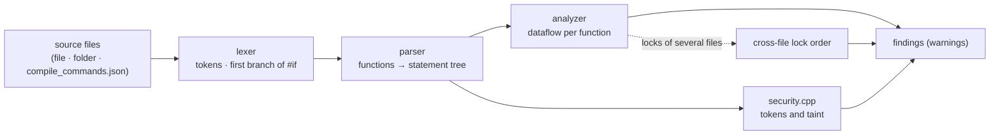

*No compiler front end: tokens, then functions, then a flow over the statements. It runs anywhere and takes milliseconds, at the price of not seeing types or macros.*

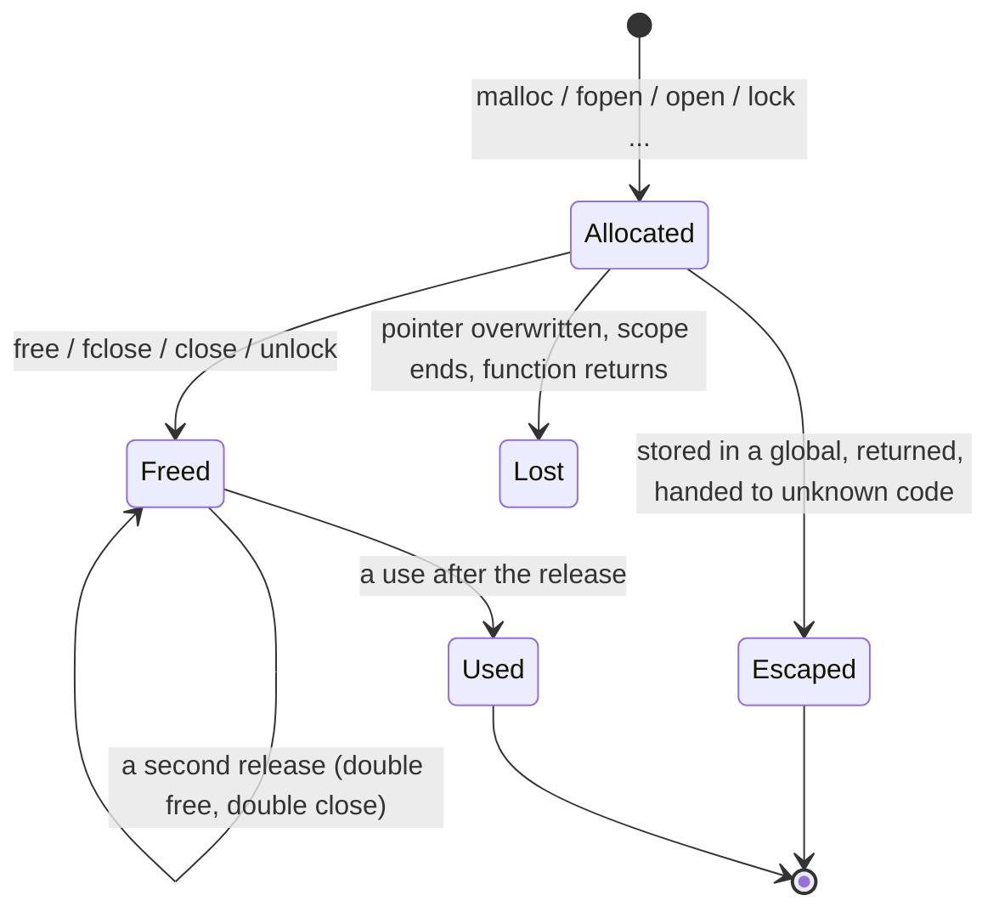

*Each allocation site is an abstract object in a set of states; what the program does to the pointer moves it between them. Escaped is a state nobody judges.*

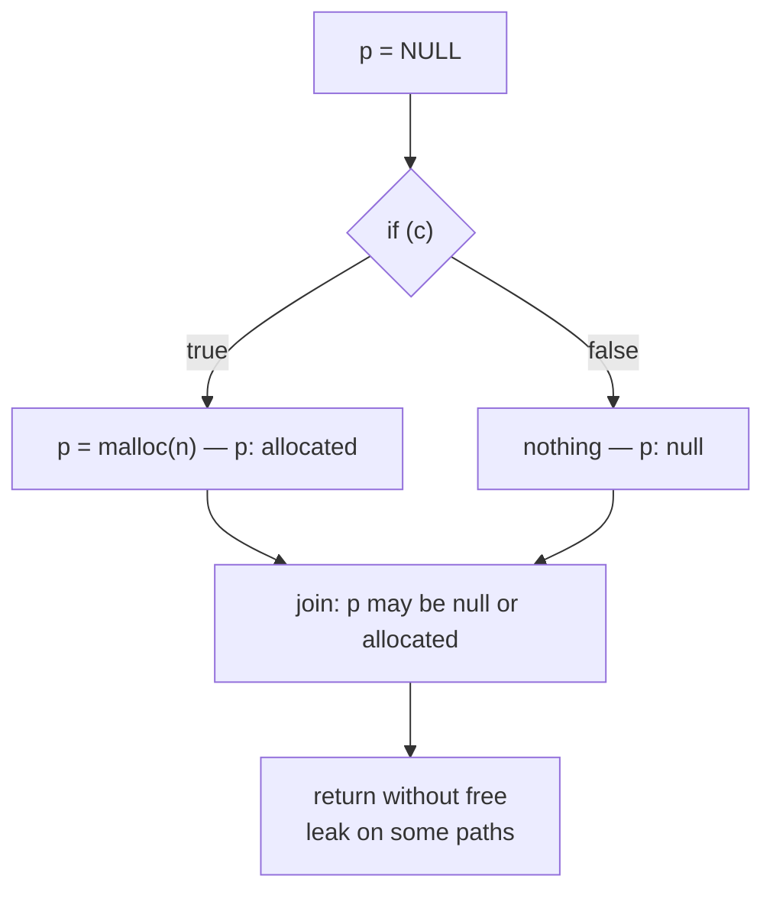

*Branches join by union, so a leak that happens on only one path is reported as "on some paths", and loops are run until nothing changes.*

1. **Lexer**: C/C++ tokens with line and column. Comments are dropped. For
   `#if`/`#ifdef`, only the first branch (or the `#else` of `#if 0`) is
   kept, like ctags. Keeping every branch would duplicate braces and merge
   functions.
2. **Parser**: finds function definitions at namespace and class scope
   (including constructors with initializer lists, operators, destructors),
   then builds a statement tree: blocks, `if`/`else`, loops, `switch`/`case`,
   `return`, `break`/`continue`, `goto`/labels, `try`/`catch`. Expressions
   stay flat token lists.
3. **Analyzer**: a forward dataflow per function. Each allocation site is an
   abstract object whose state is a set of {null, allocated, freed, escaped,
   external}. Each pointer variable or access path (`p`, `s->buf`) maps to
   the sites it may point to. Joins take unions. Loops iterate to a fixpoint.
   `goto` carries state to its label, which is how C cleanup blocks are
   handled. Null checks (`if (!p)`, `p == NULL`, `(p = malloc(n)) == NULL`)
   narrow the state on each branch. Braced blocks are scopes: at the `}`,
   what only the block's own variables held is lost ("goes out of scope",
   which is also how a loop body leaks per iteration), and a variable that
   hid one of an enclosing block or a parameter gives the name back. (States
   leaving a block through `break`, `continue` or `goto` skip that step.)

   Allocators: `malloc`-family returns, `strdup`/`wcsdup`, `realpath(p,
   NULL)` and `getcwd(NULL, n)` (a buffer only when given none), and
   out-parameters: `asprintf(&p, ...)`, `vasprintf` and `posix_memalign(&p,
   ...)` bind a new block to `p`, while `getline(&p, ...)`/`getdelim` grow
   the one `p` holds (it is the caller's even when the call fails). A test
   of the call's result, or of a variable it was stored in (`rc =
   posix_memalign(...); if (rc)`), says on which branch nothing was
   allocated: -1 for `asprintf`, nonzero for `posix_memalign`.

   Helpers of the same file count too. Functions are analyzed in file
   order; one whose every `return` hands over memory it allocated itself
   (a `malloc`-family call, `new`, another such helper, or a local still
   bound only to such a block and not stored anywhere) or `NULL` becomes
   an allocator for the functions after it, released the way it allocated
   (`free`, `delete`, `delete[]`). That covers `xmalloc`/`xstrdup`
   wrappers and factories. A result also kept in a list or global, a
   pointer into the caller's memory, a static buffer, or a mix of fresh
   and other returns does not qualify; nor do member functions (two
   classes may share a name). A helper defined after its caller is not
   known to it.

   Releasers work the same way. A function that releases a pointer
   parameter on every way out (`free`, `delete`, a closer, another
   releaser), or finds it null there (`if (!p) return;` narrows a
   parameter to null on that branch), releases that argument for later
   callers: `obj_destroy(o); obj_destroy(o);` is a double free, a use after
   it a use after free, and the helper's own release is checked against
   the allocation (`delete` of a `malloc`'d block). A helper that keeps the
   argument on some way out (`if (--refs > 0) return;`) is not one.

   Ownership leaves the function (and stops leak reports) when a pointer is
   returned, stored outside the function, captured by a lambda, put in an
   initializer, or passed to a function that is not a known non-owning libc
   function. Findings:

   * leak at a `return`/function end, when overwritten (also by the same
     allocation on a later loop iteration), or when a loop-scoped pointer
     is redeclared; "on every path" vs "on some paths";
   * `realloc(p, n)` assigned back to `p`;
   * double free and use after free (only reported when the pointer is freed
     on every path reaching the use);
   * `free` of `&local`, a local array, a string literal, or an advanced
     pointer;
   * `new[]`/`delete`/`free` mismatches;
   * dangling pointers: returning `&local` or a local array, or leaving the
     address of a local in a global or a pointed-to object when returning.

   Handles are sites too: `fopen`-family streams, `popen` streams, `DIR`
   streams and descriptors, each with its closer (`fclose`, `pclose`,
   `closedir`, `close`). The same machinery gives resource leaks, double
   close, use after close and closer mismatches. Openers are recognised
   only with their real argument count, so a C++ `file.open(path)` or a
   one-argument `open(x)` is not a descriptor. A descriptor lives in an
   `int`, so the variable that receives one owns it like a pointer would;
   `-1` is its null, and only sign tests (`fd < 0`, `fd == -1`, `fd >= 0`,
   `fd != -1`, also written constant first) narrow it (`if (!fd)` says
   nothing about failure). `fcntl(fd, F_DUPFD, ...)` and the `mkstemp`
   family create descriptors like `open` does. Passing a closed descriptor
   to an I/O call is a use; printing its number is not.

   A stream site (`FILE *`, `DIR *`) also starts in `State::unchecked` (a
   set joined by union, kept apart from the bits, which many checks
   compare with `== kAlloc` exactly). It leaves the set when a condition
   names the variable (`refine`), when the statement tests it next to
   `!`, `==`, `!=`, `&&`, `||` or `?`, and when it is passed to any call
   that is not a stream function or escapes. A stream call given a
   variable whose sites are all still unchecked is an `unchecked-stream`,
   once per open. Uses inside a condition are seen before the condition
   narrows anything, so `while (fgets(buf, n, f))` right after the open is
   reported.

   A thread handle is one more: `pthread_create(&t, NULL, ...)` binds `t`
   like `posix_memalign(&p, ...)` binds `p` (a nonzero result means no
   thread, also through a variable holding the result), and
   `pthread_join`/`pthread_detach` release it, so a second one is a
   `double-join` and a handle never released on some path a
   `resource-leak`. A thread started with attributes is not followed (they
   may make it detached), nor one whose handle goes into an array or a
   member. A released handle is a number, never "used".

   A `va_list` is a handle too: `va_start(ap, x)` and `va_copy(ap, src)`
   open a site on the plain local `ap` (never `l->args`), `va_end(ap)`
   closes it, so a path that returns without it is a `resource-leak`, a
   restart over a live list leaks the first ("is overwritten"), and a second
   `va_end` is a `double-close`. Handing `ap` to a `v*` function does not
   release it; handing it to an unknown function escapes it. A list is not
   "used" after it ends.

   Address lists are out-parameter allocators too: `getaddrinfo(h, s, hints,
   &res)` and `getifaddrs(&list)` bind `res`/`list` (`kOutAllocs` records
   which argument; a nonzero result from `getaddrinfo`, `-1` from
   `getifaddrs`, means no list, so `!= 0`, `< 0` and `== 0` tests all narrow
   correctly). The site kind is `AddrList`: only `freeaddrinfo`/`freeifaddrs`
   release it, `free()` on it is an `alloc-dealloc-mismatch`, and both
   functions are in `kNoUse`, so a second call is a `double-free` without an
   extra use-after-free. Walking the list (`p = res; p = p->ai_next`) is an
   alias, not an escape. A socket opened per address in a `connect` loop is
   an ordinary descriptor site, so one left open when `connect` fails is a
   `resource-leak`.

   Two checks need loop context rather than states. Every loop entry in
   `loops_` carries `modified` (the roots assigned, stepped with `++`/`--`
   or declared with an initializer anywhere in it, header included:
   `assigned_roots`, `note_modified`) and `waits` (a call from
   `kThreadWaits`, such as `pthread_join` or `sem_wait`, inside it). A
   `pthread_create(..., &v)` whose `v` is a plain local that the innermost
   loop modifying it changes, with no wait in that loop, is a
   `thread-stack-argument`; passing an address the loop leaves alone is a
   shared context and is not judged. The same rule covers lambdas
   (`check_thread_lambdas`, `lambda_body`): in a statement that starts a
   thread (`std::thread`, `jthread`, `async`, or `emplace_back` on a local
   declared with a thread in its type) each lambda's capture list is read
   (`[&]`, `[&x]`, `[x]`, `[&, x]`, init-captures), the body's names minus
   what it declares itself are the locals it uses, and one finding names the
   ones captured by reference that the loop changes (a lambda's own writes
   are not the loop's), or that a `detach()` leaves behind (a thread
   declared here and detached later is remembered in `ref_threads_`).
   `std::thread t(...)` with arguments is a Thread site like a
   `pthread_create` handle (`starts_std_thread`): `t.join()`/`t.detach()`
   close it (through a one-token copy, since `path_at` would run on into
   `.join`), `t.joinable()` escapes it, a move or a call that takes it
   escapes it, and one still open at a scope end or return is a
   `resource-leak`. `pthread_cond_wait`/`cnd_wait` with
   no non-switch loop around it (and no `goto` in the function) is a
   `spurious-wakeup`.

   Before a statement is analyzed (`exec`), its tokens are cleaned up. A
   lambda's body (`lambda_body`) and a deferred-cleanup macro's block
   (`K_DEFER(x) { delete p; }`, `K_DEFER { p->Unref(); }`, any name with
   defer, scope_exit, scope_guard, finally or on_exit in it:
   `defer_block`) run later, if ever, so they are cut out
   (`without_lambda_bodies`); the names they mention are treated as handed
   over (escaped), and a global a deferred block assigns is taken as put back
   (`restored_by_defer_`, so `exec_call = &call` is not a dangling pointer).
   Without this a `delete` inside a lambda ran where the lambda was made
   (koffi, strata). `a = b = malloc(n)` is split into `b = malloc(n); a = b`
   (`split_chain`). `std::shared_ptr<T>(p)` (also unique_ptr, intrusive_ptr,
   scoped_ptr) is a call that takes `p`, and `obj->Wrap(self)` (node's
   ObjectWrap) takes `obj`.

   Lock guards (`acquire_guard`, `take_lock`): a statement that declares a
   `std::lock_guard`, `std::unique_lock` or `std::scoped_lock` over one
   mutex path takes that lock like `m.lock()` does (double-lock check only
   when the template argument names a non-recursive mutex; orders; what the
   function locks), but the site is a guard site (`guard_sites_`, skipped by
   the lock-leak check) and the mutex is registered in the innermost
   `Scope::guards`, released by `leave_scope` and by `break` (`release_guards`
   down to the loop's `Loop::scopes`). `guard_mutex_` maps the guard variable
   to its mutex so `lk.lock()`/`lk.unlock()` act on it; `defer_lock` only
   maps, `adopt_lock` registers the release, `try_to_lock` is skipped. A
   guard's declaration looks like a call `g(m)`, which would escape the
   mutex, so `is_lock_guard_decl` exempts it. `continue` is not handled: the
   state at the loop head merges with the entry state, so the mutex is
   never "certainly held" there anyway.

   A held mutex is a site too, bound to the pseudo path `lock:<mutex>`
   (the mutex as written, `&` dropped). `lock(&m);` as a whole statement
   binds a new site; an unlock marks the bound sites released. At a return,
   a lock bound to one site on every incoming path (no "never locked" path
   joined in) that is still allocated is a `lock-leak`; locking a mutex
   whose single site is allocated is a `double-lock`. Both are kept only if
   the function unlocks that mutex somewhere, which separates bugs from
   lock wrappers.

   Unlocking, or waiting on, a mutex whose sites are all released (unlocked
   on every incoming path, by this function) is a `foreign-unlock` or an
   `unlocked-wait`; with some released and the rest allocated it is the
   "may" form, as `double-free` treats a block freed on some paths, and as
   there, a path that never locked it here (site 0) makes no claim. The
   "may" form is not judged inside an `if` (a depth counter): the
   condition may be the flag that tells the paths apart. An unlock there
   of a mutex released on some paths marks its sites escaped, which also
   keeps the `lock-leak` exit check off the `if (locked) unlock` idiom.
   The released state is
   withdrawn (the site marked escaped) by anything that may lock the
   mutex unseen: a lock call whose result is tested, which `acquire` does
   not follow, and any call not known to leave locks alone that can reach
   the mutex: always for a global or member mutex (its root is not a
   local or parameter) or a method call, else when an argument names the
   mutex's root (`ctx_lock(c)` for `c->mu`).

   Locking B while A is bound to one allocated site records the order
   A -> B (with both lines). After all of a file's functions,
   `lock_inversions` pairs A -> B with B -> A when both mutexes are
   declared at file scope (outside any braces, by `file_scope_names`): a
   pointer's or `this`'s member named alike in two functions may be two
   objects. The pair is reported at the later of the two, as a
   `lock-order-inversion` with the earlier function's line. Longer cycles
   are not searched (the dynamic engine finds those). Orders between
   file-scope mutexes not declared `static` (`file_scope_names` with
   `shared_only`; an `extern` declaration counts) are kept with their file
   for a last pass over all files, which reports only pairs whose two
   orders come from different files: the same name is the same object
   across files, while a `static` one is each file's own.

   Orders through helpers: every lock also records what its function
   locks (an order with nothing held), and every call made while a mutex
   is certainly held records the callee (`LockOrder::via`). After the
   file, `with_calls` turns "holding A, calling g" into A -> B for each B
   that g locks itself, so the callee may come later in the file. One
   level: g's own callees are not followed. Member calls are not, either
   (`x.g()` may be any class's).

4. **Signal handlers** (`signal_unsafe_calls`, per file, after the
   functions): handlers are the single identifiers (or `&name`) installed
   by `signal(sig, h)` or assigned to a `.sa_handler`/`.sa_sigaction`
   member, designated initializers included. A function of that name whose
   lines hold a call to the dynamic engine's unsafe list (an identifier
   followed by `(`, not a member call) is a `signal-unsafe-call`, with the
   install line as the related location. So is a call, in the handler, to
   a function of the file whose own lines call one directly (reported at
   the handler's call, naming the helper). One level only: the helper's
   helpers are left to dynamic mode. The handler's own name on its
   definition line looks like a call and is skipped.

Run over llama.cpp (1,192 files in 2.7 seconds), it reports eleven
findings, all real: four globals or members still pointing at a local when
the function returns, two `FILE` streams not closed on an early return,
and five unsafe calls in the SIGINT handlers of `llama-cli` and
`llama-server` (`fprintf`, `fflush` and `exit` on a second Ctrl+C, where
`write` and `_exit` are safe).

### Source weaknesses (`security.cpp`)

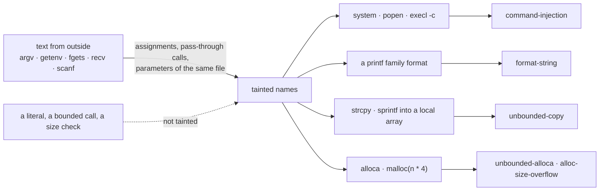

*A finding needs both ends: text that came from outside and a call that cannot take it. Everything the checks leave alone (a literal format, a copy from a shorter array) is pinned by the unit tests.*

After the dataflow, each file is read again for mistakes about the text
rather than about ownership. `security_issues` walks the functions the parser
found. A name is tainted when it is `argv`, when it is assigned from
`getenv`/`fgets`/`recv`/..., or when it is a parameter of a function in the
file that was itself called with tainted text. The findings are the rows in
the reference ([REFERENCE.md](REFERENCE.md), "What the source can be made to do"): `format-string`,
`command-injection`, `unbounded-copy`, `unbounded-alloca`, `unsafe-function`,
`hardcoded-secret`, `toctou-race`, `insecure-permissions`, `weak-crypto`, `sizeof-pointer`,
`alloc-size-overflow`, `tls-no-verify`.
`unbounded-alloca` is `alloca` / `__builtin_alloca` whose size is not a
constant expression and names text from outside (or a variable assigned
from such a size, cleared again when that variable is assigned a constant).
`sizeof-pointer` is a `memset`/`memcpy`/`memmove` whose size
is written `sizeof(p)` with `p` a pointer (a `malloc`'ed name, an alias of one, or a
parameter): only the pointer's own bytes are touched. `sizeof` of a real array, and
`sizeof *p`, are correct. `alloc-size-overflow` is a `malloc`/`realloc` whose size
multiplies a name that holds outside text or an outside-derived size; the product
can wrap around, and unlike `calloc` these do not check it (a guard the tokens do
not see may still bound the factor: a warning can name an impossible path).
`tls-no-verify` is `SSL_CTX_set_verify`/`SSL_set_verify` given `SSL_VERIFY_NONE`.
They are static
warnings. The checks that keep ordinary code quiet are the ones the unit
tests pin down: a format that is one literal, a macro used as a format, a
copy from a shorter array, `scanf` with a width, `chmod 0644`, a password
prompt, and `open` with `O_EXCL` or `O_NOFOLLOW` after `access`.

#### The route, and files that call each other

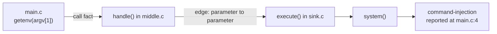

*One fact per file, joined after the pool of workers has finished: the finding lands at the call that handed the text on, and prints the path.*

The checks above read one file at a time, so `main` in one file reading `argv`
and `system` in another running it were two unrelated files. Three facts
per file close that gap. They are recorded while the file is read and joined
once every file has been (`lcstatic::TaintDb`, `resolve_taint`):

* **where text entered** — every name tainted during the read remembers the
  step that brought it in (`Context::origin`): `argv`, `getenv()`, `fgets()`, or
  a parameter. That is what the report prints as the first line of the route.
* **what a parameter reaches** — a pass at the end of each file reads it again
  with every parameter treated as if the caller had put outside text there, and
  records, for each parameter, the dangerous call it arrives at (`TaintSink`).
  A cheap gate skips the pass when the function never calls anything on the
  sink list, which is what keeps the extra read from costing much. This pass
  reports nothing; it only fills facts.
* **what is passed on** — a call that hands one function's parameter to
  another's parameter is an edge (`TaintEdge`), tainted or not, because whether
  it carries anything is the caller's business. A call that hands text from
  outside to a function this file does not define is a starting point
  (`TaintCaller`).

After the merge, each starting point is followed depth-first through the edges
until a parameter reaches a sink — through as many files as the text travels —
and the finding is written where the text was passed on, with the chain as its
route. Depth is capped and a parameter is visited once per path, so a cycle in
the call graph ends the walk rather than the process. One finding per dangerous
call: when two callers reach the same `system()`, the route with the most steps
wins, because that one names the entry point an attacker uses.

False alarms were the constraint. Only text that came from outside starts a
walk; a function whose parameter reaches a shell but is only ever called with a
literal stays silent (`h72_trap_xfile_literal` in the eval suite), and the four
files of `static_flow_crosses_files` pin the route, the JSON `flow`, the
SARIF `codeFlows` and the trap in `tests/run_tests.py`.

## File scan (`scan.cpp`, `scan_engine.cpp`)

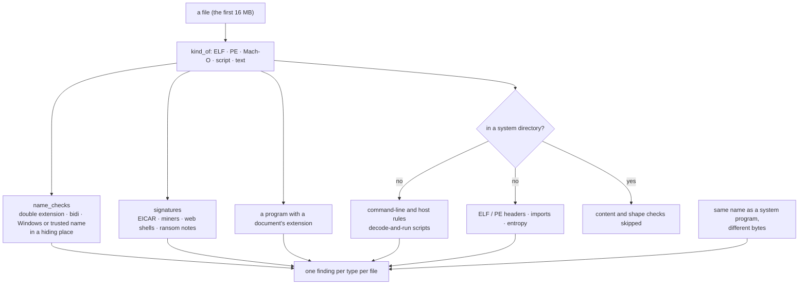

*The system's own files already contain the strings of what they do (bash has /dev/tcp), so they are judged by name and signature only.*

`leakcheck scan` walks a file or a directory (`recursive_directory_iterator`,
skipping symlinks and `/proc`, `/sys`, `/dev`), reads the first 16 MB of each
regular file under 256 MB, and does not execute anything. `kind_of` tells an
ELF, a PE, a Mach-O, a script (`#!`) and text apart. `scan_file` then:

* judges the name (`name_checks`): a double extension (`invoice.pdf.exe`), a
  bidi control, a Windows system-process name outside the Windows directory,
  a trusted name in a hiding place, a name one edit or one look-alike away;
* says when a program or a script wears a document's extension
  (`disguised-executable`);
* searches the bytes for the EICAR tail, the miner and web-shell needles, a
  ransom note (case folded) and a PHP web shell, including one that runs code from
  an encoded string (`eval(base64_decode(...))`) (`signature_checks`);
* on a script or a binary, runs the same `normalize` / `kCmds` /
  `downloads_into_interpreter` / `imitates` rules as the dynamic engine
  (`text_checks`), so the two modes agree. A text file that is not a script
  by its extension is documentation and is not read for commands;
* for an ELF or a PE, looks at program headers, section names and imported
  names (`elf_checks`, `pe_checks`, `api_checks`) and at the entropy of the
  first 4 MB.

One finding per type per file; further hits of that type are a count ("and N
more of the same kind"). `scan_engine` adds one more: a file whose name is a
trusted program's, that does not live in a system directory, and whose bytes
are not that program's (`shadowed_program`). A byte-for-byte copy is not.

A path in `system_dir` skips `string_checks`, `api_checks`, `elf_checks`,
`pe_checks` and the entropy test, and `name_checks` does not call a look-alike
there. Before that, this machine's `/usr/bin` had 24 findings, `/usr/sbin` 24
and `/usr/lib` 361 (help text, `gpasswd` next to `passwd`, compressed debug
files, WSL drivers, CPython packages). After it, the same three trees are
silent: 847, 167 and 89833 files. Signatures (EICAR, a web shell, a ransom
note) and a document's extension still apply in those directories, so a
script that was put there is not invisible, but a command line quoted in
`/usr/bin/byobu-enable-prompt` is no longer reported.


## Reporter (`reporter/`)

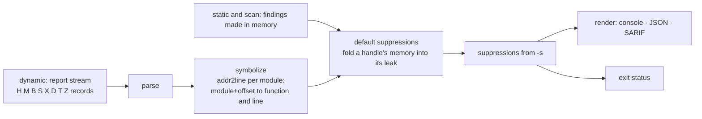

*Everything the engines find passes through here, so the formats, the suppression rules and the exit status are the same for all three modes.*


The runtime stream is line based (`shared/include/protocol.h`): a header per process, the modules a
stack mentions, one block per finding with its stacks as `module-id:offset` pairs, and a trailer. The
reporter groups frames by module and runs `addr2line` once per module (on Windows it adds the PE image
base to each offset), trims frames below `main` or the thread entry, merges equal findings from one
place into a count, and applies suppressions before the formats are written. JSON text is UTF-8,
written as `\u` escapes, so a path with letters outside ASCII is valid JSON on every system.

## Trade-offs

* **Interposition instead of compiler instrumentation.** No rebuild is needed,
  but reads of freed memory and stack/global overflows are invisible without
  guard pages. That is what AddressSanitizer's compile-time checks are for.
* **DWARF unwinding by default.** It is correct for any code, and with the
  stack interning and the bundled frame-pointer walk it costs about 1 µs per
  allocation. `--fast-unwind` walks frame pointers instead, about 4x faster on
  allocation-heavy programs, but frames compiled without `-fno-omit-frame-pointer`
  are missing from the stack. Deciding that per frame is not possible without
  running both, so the precise choice stays the default.
* **Scanning at the end of `main`.** Stale stack data cannot hide leaks.
  Memory freed only by atexit handlers is still referenced from globals at
  that point, so it is classified as reachable, not lost.
* **Static analysis without a compiler front end.** It runs anywhere and
  takes milliseconds, but types and macros are invisible. Rules are tuned for
  few false positives over completeness. Each allocation site is one abstract
  object. When a site runs again (the next loop iteration) while the
  variable it is assigned to still certainly holds the previous object, and
  no other variable does, that object is lost: reported before other
  variables drop it (untracked), so a descriptor stored in `fds[i]` on one
  iteration is not confused with the one opened on the next. A previous
  object live on some paths only is left to the scope's end.
